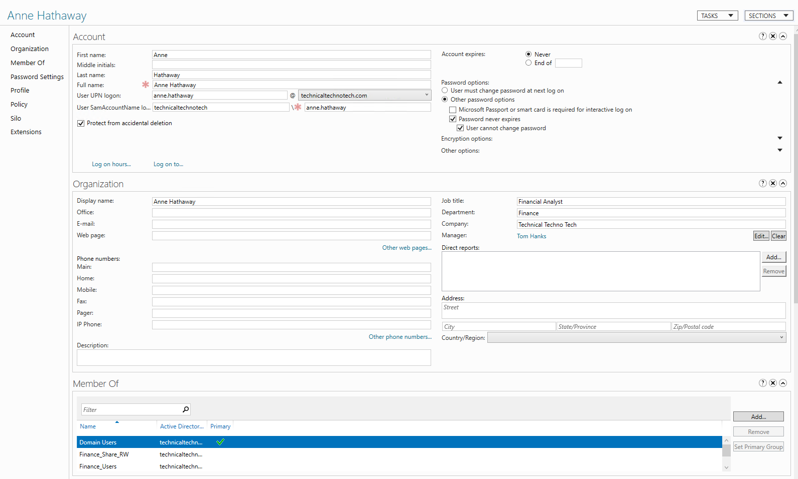
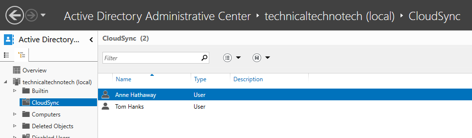
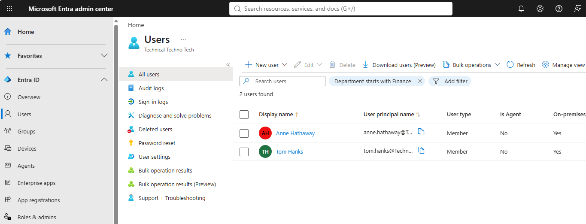
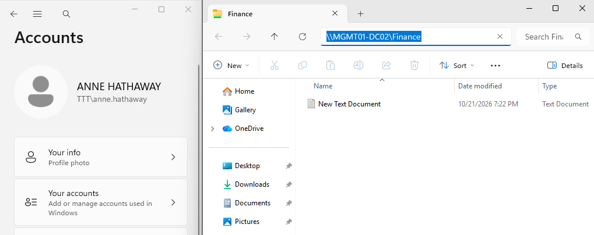

# SCN-001 - New Employee Onboarding

## Overview

### Objective

A request was received from Human Resources to onboard a new employee. The objective was to provision user accounts, assign access permissions, provide simulated Microsoft 365 services, and validate that all required resources were available before the employee's start date.

### Skills Demonstrated

- Active Directory Administration
- Microsoft Entra ID Administration
- Microsoft 365 Administration
- PowerShell
- Identity and Access Management
- Service Request Management
- Knowledge Management

## Business Requirement

Human Resources requested onboarding for a new employee, Anne Hathaway.

The employee required:

- Active Directory account creation
- Microsoft Entra ID synchronization
- Departmental security group membership
- Access to organizational resources

### Expected Outcome

The employee should be fully provisioned and able to access required resources on their first day of employment.

## Technologies Used

- Active Directory Administrative Center (ADAC)
- Windows Server
- Microsoft Entra Connect
- Microsoft Entra ID
- Microsoft 365 Admin Center
- PowerShell
- Jira Service Management

## Implementation

### Step 1 - Review Request

Reviewed the onboarding request submitted through Jira Service Management.

Verified:

- Employee details
- Department assignment
- Required access permissions

**Ticket PDF**

[Ticket](Evidence/ticket.pdf)

---

### Step 2 - Create Active Directory Account and Assign Security Groups

Created the user account in Active Directory and configured the required account properties.

Tasks completed:

- User account creation
- User logon name assignment
- Organizational Unit placement
- Initial password configuration

#### Assign Security Groups

Assigned the appropriate security groups based on the employee's department and access requirements.

Tasks completed:

- Department group assignment
- Shared resource access assignment
- Permission verification

**Screenshot**



---

### Step 3 - Synchronize to Microsoft Entra ID

Triggered synchronization between on-premises Active Directory and Microsoft Entra ID.

```powershell
Start-ADSyncSyncCycle -PolicyType Delta
```

Confirmed successful synchronization.

---

### Step 5 - Validation

Performed validation checks to confirm successful onboarding.

Validation activities:

- Verified Active Directory account
- Verified group membership
- Verified Entra ID synchronization

**Screenshot**







## Results

### Outcome

The onboarding request was fulfilled successfully.

Completed actions:

- Active Directory account created
- Security groups assigned
- Microsoft Entra ID synchronization completed
- Validation completed successfully

### Business Impact

The employee received all required accounts and access before beginning work, reducing onboarding delays and ensuring productivity on day one.

## Documentation Updates

As part of the onboarding process, supporting documentation was created and updated to reflect the completed work and improve future operational efficiency.

### Service Request Management

A Service Request record was created to document:

- Request intake and authorization
- User provisioning activities
- Access assignments
- Validation results
- Request fulfillment and closure

**Record:** SR-001 – New Employee Onboarding

### Knowledge Management

A Knowledge Base article was created to provide a standardized onboarding procedure for future technicians.

The article includes:

- Onboarding prerequisites
- Account creation procedures
- Microsoft 365 provisioning steps
- Validation processes
- Common issues and troubleshooting guidance

**Article:** KB-001 – New Employee Onboarding

### Infrastructure Documentation

The Active Directory documentation was updated to reflect the current environment configuration.

Updates included:

- Organizational Unit (OU) structure
- Active Directory overview
- Group and user management standards
- Hybrid identity synchronization configuration
- Microsoft Entra Connect integration

These updates ensure that operational records, technical procedures, and infrastructure documentation remain aligned with the current environment.

## Related Documentation

### Operational Records

- SR-001 New Employee Onboarding

### Knowledge Articles

- KB-001 New Employee Onboarding

## Lessons Learned

### Technical Lessons

- Hybrid identity synchronization between Active Directory and Microsoft Entra ID
- Microsoft 365 license assignment workflow
- Security group based access management

### Process Lessons

- Importance of validating authorization before provisioning access
- Value of standardized onboarding procedures
- Relationship between Service Request Management and Knowledge Management

### Improvement Opportunities

- Create role-based access templates for common employee types
- Automate account provisioning through PowerShell
- Expand onboarding documentation to cover additional departments

## Skills Practiced

### Technical

- Active Directory Administration
- Microsoft Entra ID Administration
- Microsoft 365 Administration
- PowerShell
- Identity Management

### IT Service Management

- Service Request Management
- Knowledge Management
- Technical Documentation
- Access Control Administration