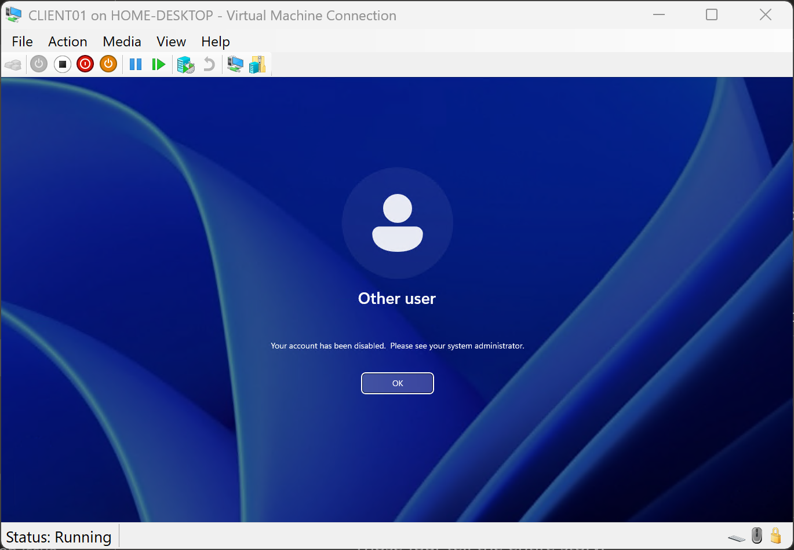
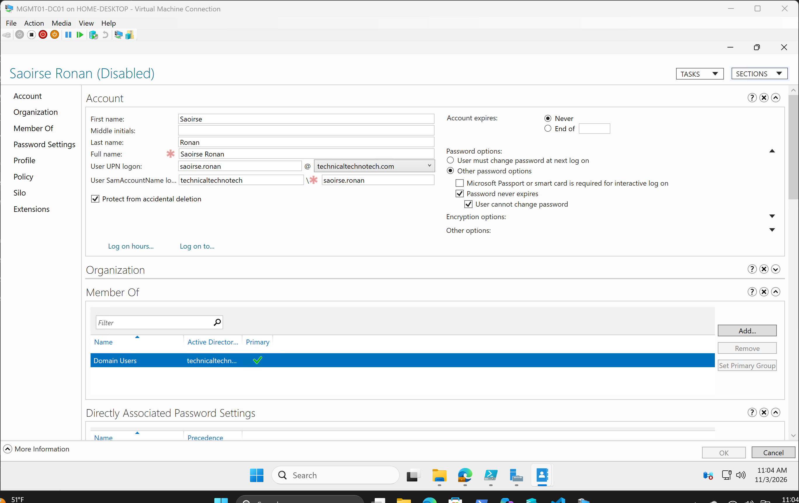
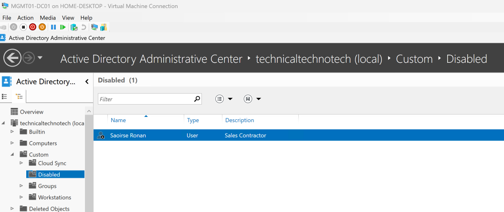
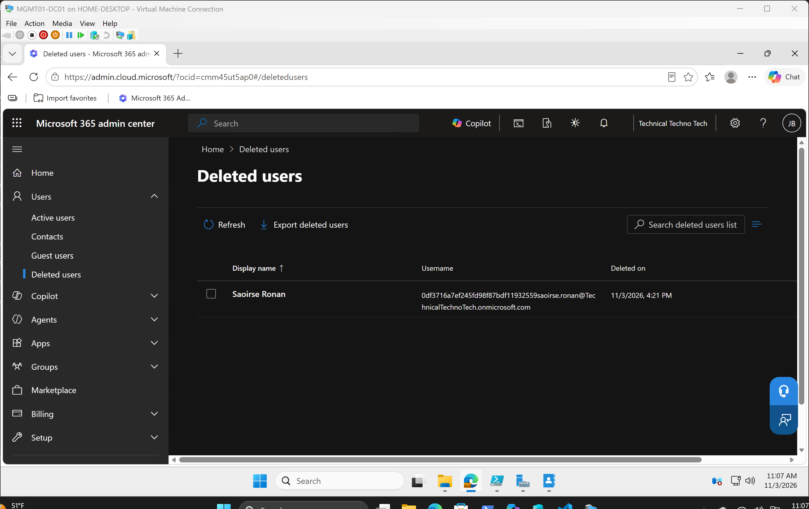

## SCN-002 - Contractor Offboarding

### Overview

#### Objective

Human Resources submitted a request to offboard a contractor whose engagement with Technical Techno Tech had concluded.

The objective was to securely remove organizational access from both on-premises and cloud environments while validating that access had been revoked.

#### Skills Demonstrated

- Active Directory Administration
- Microsoft Entra ID Administration
- Identity and Access Management
- User Lifecycle Management
- Service Request Fulfillment

---

### Business Requirement

Human Resources requested the offboarding of Saoirse Ronan following the completion of an IT contractor engagement.

The underlying request included:

- Account disablement
- Removal of security group memberships
- Removal of resource access
- Cloud access revocation

#### Expected Outcome

The contractor should no longer have access to organizational resources, systems, or cloud services.

---

### Technologies Used

- Active Directory
- Microsoft Entra ID
- Microsoft Entra Connect
- Windows Server
- PowerShell

---

### Implementation

#### Step 1 - Review and Verify Request

Reviewed the Service Request and verified authorization.

Validation included:

- Request review
- HR approval verification
- Contractor identification
- Offboarding scope confirmation

---

#### Step 2 - Disable Account and Remove Access

Performed account lifecycle actions within Active Directory.

Activities performed:

- Disabled user account
- Removed departmental security groups
- Removed resource access groups
- Reviewed remaining permissions

**Screenshot**



**Screenshot**



---

#### Step 3 - Move Account to Disabled Users OU

Moved the account to the Disabled Users Organizational Unit.

This ensures the account remains available for retention purposes while preventing organizational access.

**Screenshot**



---

#### Step 4 - Synchronize Microsoft Entra ID

Executed a Microsoft Entra Connect synchronization.

```powershell
Start-ADSyncSyncCycle -PolicyType Delta
```

The synchronization propagated account changes to Microsoft Entra ID.

---

#### Step 5 - Validate Cloud Access Revocation

Verified the account no longer had access to organizational cloud services.

Validation included:

- Entra ID account review
- Sign-in access verification
- User state validation

**Screenshot**



---

### Results

#### Outcome

The contractor was successfully offboarded.

Completed actions:

- Account disabled
- Resource access removed
- Security groups removed
- Disabled Users OU placement completed
- Entra synchronization completed
- Cloud access revoked

#### Business Impact

Organizational access was removed following the contractor's departure, reducing security risk and ensuring access control requirements were met.

#### Closing Ticket

[Ticket](./Evidence/ticket.pdf)

---

### Documentation Updates

#### Service Request Management

A service request record was created documenting:

- Authorization
- Fulfillment activities
- Validation
- Closure

**Record:** [SR-002 - Contractor Offboarding](../../Service-Request-Management/Records/SR-002.md)

#### Knowledge Management

A knowledge article was created documenting the contractor offboarding process.

**Article:** [KB-002 - Contractor Offboarding](../../Knowledge-Management/Articles/KB-002-Offboarding.md)

#### Infrastructure Documentation

The Active Directory environment was updated to reflect:

- Disabled account status
- User lifecycle changes

---

### Review and Evaluation

#### Service Desk Review

A Service Desk Review was conducted to evaluate:

- Ticket management
- Communication
- Technical execution
- Documentation quality

**Review:** [SDR-001 - Contractor Offboarding Review](../../Service-Desk/Records/SDR-001.md)

---

### Lessons Learned

#### Technical Lessons

- Disabled accounts cannot authenticate even when inherited permissions remain.
- Microsoft Entra Connect synchronization is required to propagate identity changes to the cloud.
- Group-based access management simplifies offboarding activities.

#### Process Lessons

- Validation should be performed before ticket closure.
- Customer-facing communication should remain understandable to non-technical users.
- Authorization should be verified before making identity changes.

#### Improvement Opportunities

- Create a standardized offboarding checklist.
- Automate user lifecycle tasks using PowerShell.
- Expand identity lifecycle documentation.

---

### Skills Practiced

#### Technical

- Active Directory Administration
- Microsoft Entra ID Administration
- PowerShell
- Identity and Access Management
- User Lifecycle Management

#### IT Service Management

- Service Request Management
- Change Documentation
- Validation Procedures
- Customer Communication