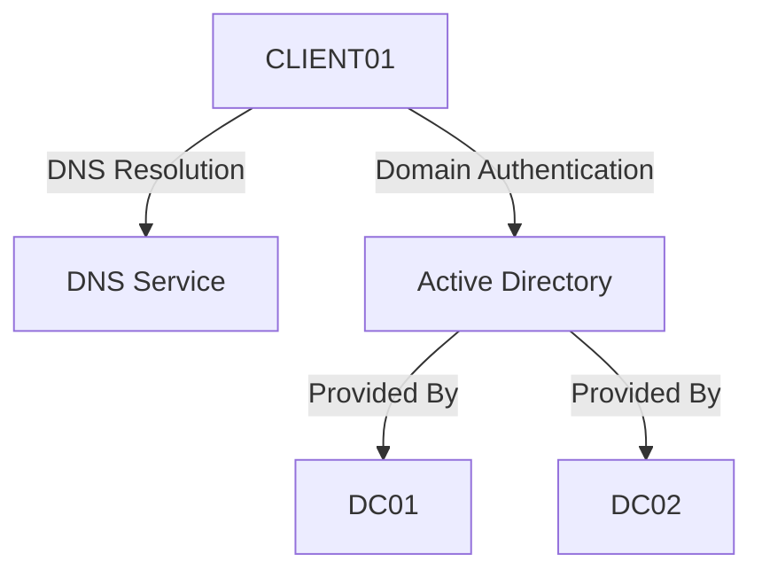
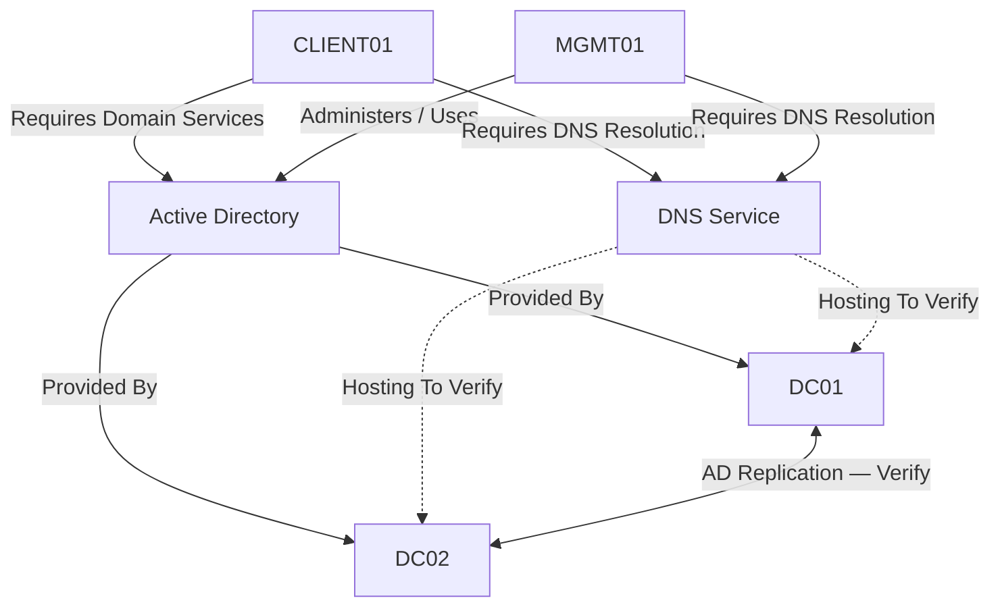
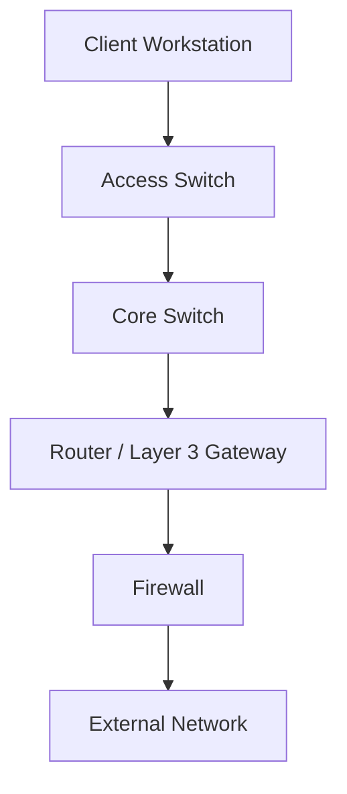
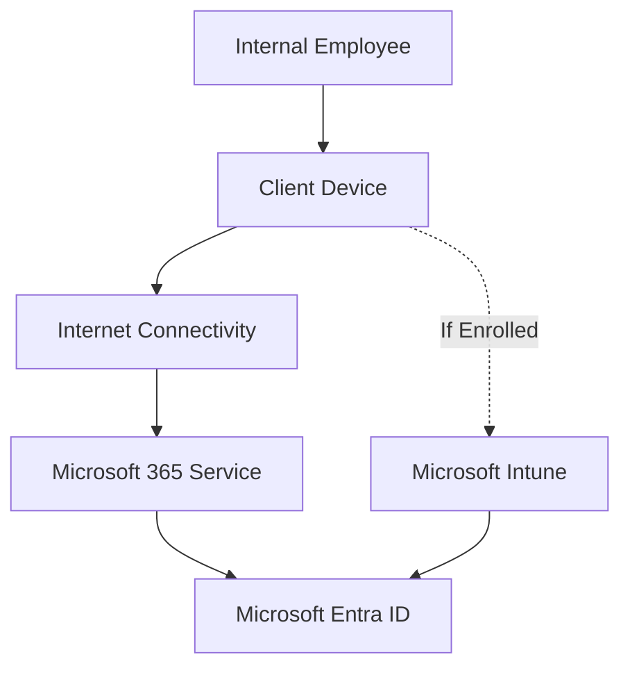
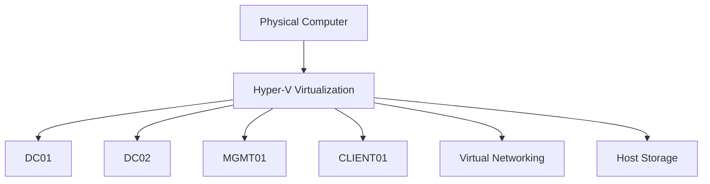

# IT Service Dependency Mapping

**Organization:** Technical Techno Tech (TTT)  
**Practice:** Service Configuration Management  
**Document Type:** Dependency Mapping Guide  
**Document ID:** GUIDE-SCM-002  
**Version:** 1.0  
**Status:** Draft — Lab Documentation Standard  
**Function:** Internal IT  
**Classification:** Public Portfolio — Sanitized Lab Documentation

---

## 1. Purpose

This directory contains the IT service and infrastructure dependency maps for Technical Techno Tech's simulated corporate environment.

Dependency mapping identifies and documents the relationships between Configuration Items (CIs), infrastructure components, applications, and IT services.

The purpose is to provide a consistent method for understanding how technical components work together to deliver IT services.

Dependency maps support:

- Infrastructure documentation
- IT service visibility
- Incident investigation
- Service impact analysis
- Problem investigation
- Root cause analysis
- Change impact assessment
- Monitoring and event correlation
- Information security risk assessment
- Disaster recovery planning
- Infrastructure modernization
- Continual improvement

**Key Principle:** A dependency map should explain how components support one another and what may happen when a dependency becomes unavailable.

---

## 2. ITIL 4 Alignment

Dependency mapping supports the ITIL 4 Service Configuration Management practice.

### Practice Purpose

The purpose of Service Configuration Management is to ensure that accurate and reliable information about the configuration of services, and the configuration items that support them, is available when and where needed.

Dependency maps complement Configuration Item records by documenting relationships between components.

### Configuration Item vs. Dependency Map

| Configuration Item Record | Dependency Map |
|---|---|
| Describes an individual managed component | Describes relationships between components |
| Records configuration attributes | Records service dependencies |
| Identifies ownership and lifecycle status | Identifies how components interact |
| Supports configuration verification | Supports impact and dependency analysis |
| May reference multiple related CIs | May include multiple CIs and services |

### Example

A domain controller CI record may document:

- Hostname
- Operating system
- IP address
- Installed roles
- Operational status
- Related services

A dependency map may show:

- Workstations using Active Directory
- Domain controllers providing authentication
- DNS supporting domain controller discovery
- Network connectivity supporting communication

### Important

A dependency map is not necessarily a complete network topology diagram.

A network topology focuses on network connections and architecture.

A dependency map focuses on relationships required for service delivery.

The same diagram may include both types of information when appropriate.

---

## 3. Directory Scope

This directory contains dependency documentation for Technical Techno Tech's internal IT services and supporting infrastructure.

### Supported Environments

- Active Directory Domain Services
- Windows Server
- Windows 11
- Microsoft Entra ID
- Microsoft 365
- Microsoft Intune
- Microsoft Azure
- Hyper-V
- Network infrastructure
- OPNsense
- VyOS
- Cisco Packet Tracer

### Supported Internal IT Services

| Service ID | Service |
|---|---|
| IT-SVC-001 | Identity & Access Management |
| IT-SVC-002 | Endpoint Management |
| IT-SVC-003 | Microsoft 365 & Collaboration |
| IT-SVC-004 | Network Connectivity |
| IT-SVC-005 | Server & Infrastructure Services |
| IT-SVC-006 | Information Security |
| IT-SVC-007 | Employee IT Lifecycle |

Dependency maps may support one or multiple services.

---

## 4. Directory Structure

### Proposed Structure

```text
Dependency-Maps/
├── README.md
├── DM-001-Active-Directory-Dependencies.md
├── DM-002-Network-Infrastructure-Dependencies.md
├── DM-003-Microsoft-365-Dependencies.md
├── DM-004-Endpoint-Management-Dependencies.md
└── DM-005-Server-Infrastructure-Dependencies.md
```

These are proposed documentation files.

Create individual dependency maps when the corresponding infrastructure and relationships are ready to be documented.

### Organization Rules

1. Store dependency maps in this directory.
2. Use consistent filenames.
3. Assign a unique map identifier.
4. Identify the services covered.
5. Reference relevant Configuration Item records.
6. Document verified relationships.
7. Identify unknown or unverified dependencies.
8. Update maps when relevant infrastructure changes occur.

### Important

Do not create diagrams that imply systems are deployed or integrated unless the underlying relationships have been verified.

---

## 5. Dependency Map Identification

Each dependency map should have a unique identifier.

### Proposed Naming Convention

```text
DM-###
```

### Examples

```text
DM-001
DM-002
DM-003
DM-004
```

### File Naming Convention

```text
DM-###-Dependency-Name.md
```

### Example

```text
DM-001-Active-Directory-Dependencies.md
```

### Identification Rules

- Do not reuse map identifiers.
- Retain the same identifier throughout revisions.
- Reference the map identifier in related documentation.
- Use descriptive filenames.
- Maintain revision history.
- Identify the responsible documentation owner.

---

## 6. Dependency Map Types

Technical Techno Tech uses several proposed mapping categories.

### 6.1 Service Dependency Map

Shows the components required to deliver an IT service.

**Example:** Identity & Access Management depends on directory services, authentication infrastructure, and supporting network connectivity.

### 6.2 Infrastructure Dependency Map

Shows relationships between infrastructure components.

**Example:** A virtual machine depends on a virtualization host and associated storage.

### 6.3 Application Dependency Map

Shows services required by an application.

**Example:** An application may depend on DNS, authentication, network connectivity, and a database.

### 6.4 Network Dependency Map

Shows network components and communication dependencies.

**Example:** A workstation may depend on a switch, router, and firewall to reach a remote service.

### 6.5 Cloud Service Dependency Map

Shows relationships between cloud services and supporting identities, devices, or resources.

**Example:** A managed Windows endpoint may rely on Microsoft Entra ID and Intune for particular management functions.

### 6.6 Security Dependency Map

Shows components supporting security controls.

**Example:** Administrative access may depend on identity services, authentication controls, and authorization assignments.

### Important

These categories may overlap.

A single map can represent multiple dependency types when that improves clarity.

---

## 7. Dependency Relationship Types

Relationships should describe how components interact.

| Relationship | Description |
|---|---|
| Depends On | One component requires another to perform a function |
| Supports | A component contributes to delivery of a service |
| Hosts | A platform provides an execution environment |
| Hosted On | A component operates on another platform |
| Connects To | Components communicate through a network or interface |
| Authenticates Through | A component relies on an identity or authentication service |
| Resolves Through | A component relies on DNS name resolution |
| Managed By | A component is administered through a management platform |
| Monitored By | A component is observed by a monitoring system |
| Protected By | A component relies on a security control |
| Replicates With | Components exchange replicated information |
| Provides Service To | A component supplies functionality to another component |
| Routes Through | Traffic traverses a routing component |
| Stores Data On | A component uses another resource for data storage |

### Relationship Requirements

Each relationship should identify:

1. Source component
2. Target component
3. Relationship type
4. Purpose
5. Relevant service
6. Verification status
7. Supporting evidence where available

### Important

Relationship direction must be clear.

For example:

**CLIENT01 depends on DNS** is not the same statement as **DNS depends on CLIENT01**.

---

## 8. Dependency Direction

Dependency direction helps determine which services may be affected by a component failure.

### Example

```text
CLIENT01
   |
   | Depends On
   v
DNS Service
```

In this example, CLIENT01 requires DNS for the relevant name-resolution function.

### Upstream Dependencies

An upstream dependency provides functionality required by another component.

### Downstream Dependents

A downstream dependent relies on an upstream component.

### Example

```text
                DNS Service
                     |
          +----------+----------+
          |                     |
          v                     v
       CLIENT01               MGMT01
```

In this diagram, the workstations are shown as consumers of the DNS service.

### Important

Dependency direction should be documented consistently.

Arrows must have an explained meaning.

A diagram should not leave readers guessing whether an arrow represents traffic flow, dependency, management, or another relationship.

---

## 9. Dependency Criticality

Not every dependency has the same importance.

### Proposed Criticality Levels

| Criticality | Description |
|---|---|
| Critical | Failure may prevent delivery of an essential service |
| High | Failure may significantly degrade service functionality |
| Medium | Failure may affect some functions or users |
| Low | Failure has limited operational impact |
| Unknown | Impact has not been evaluated |

### Evaluation Factors

- Number of affected users
- Service importance
- Availability requirements
- Redundancy
- Recovery options
- Security implications
- Business impact
- Dependency alternatives

### Important

Criticality should be based on the actual service context.

A component may be critical to one service but less important to another.

---

## 10. Dependency Redundancy

Dependency maps should identify redundant components when relevant.

### Example

```text
                Active Directory
                 Authentication
                      |
              +-------+-------+
              |               |
              v               v
             DC01            DC02
```

This conceptual diagram shows two domain controllers supporting Active Directory authentication.

### Redundancy Considerations

- Are both components operational?
- Can clients discover both components?
- Are required services available on both?
- Are replication and configuration healthy?
- Are there shared infrastructure dependencies?
- Can service continue if one component fails?

### Important

The presence of two components does not automatically establish fault tolerance.

Redundancy must be evaluated against the service's actual configuration and failure scenarios.

---

# 11. Dependency Mapping Procedure

## Step 1 — Identify the Mapping Objective

Determine why the dependency map is needed.

### Common Objectives

- Document service architecture
- Support troubleshooting
- Assess change impact
- Identify single points of failure
- Improve monitoring
- Evaluate security dependencies
- Support recovery planning

### Example

**Objective:** Document the infrastructure dependencies supporting Active Directory authentication.

**Expected Result:** A clear mapping purpose is established.

---

## Step 2 — Define the Mapping Scope

Identify the service or infrastructure area to be documented.

### Scope Elements

- Service name
- Service ID
- Environment
- Relevant systems
- Relevant applications
- Network dependencies
- Cloud dependencies
- Exclusions

### Example

**Service:** IT-SVC-001 — Identity & Access Management

**Environment:** `homelab.local`

**Potential Components:**

- DC01
- DC02
- CLIENT01
- MGMT01
- DNS services
- Network connectivity

**Expected Result:** Mapping boundaries are documented.

---

## Step 3 — Identify Configuration Items

Review existing CI records.

### Related Directory

[Configuration Items](../Configuration-Items/README.md)

### Required Information

- CI ID
- CI name
- CI type
- Operational role
- Relevant configuration
- Associated services
- Known relationships

### Example

| CI ID | CI Name | Type |
|---|---|---|
| CI-001 | DC01 | Server |
| CI-002 | DC02 | Server |
| CI-003 | MGMT01 | Workstation |
| CI-004 | CLIENT01 | Workstation |

These identifiers are proposed examples until corresponding records are created.

**Expected Result:** Relevant components are identified.

---

## Step 4 — Identify Supporting Services

Determine which technical services are required.

### Examples

- DNS
- DHCP
- Active Directory
- Authentication
- Routing
- Network connectivity
- Virtualization
- Storage
- Cloud identity
- Device management

### Example

An Active Directory domain-joined workstation may depend on:

- DNS for domain controller discovery
- Network connectivity to reach a domain controller
- Active Directory services for domain authentication
- Appropriate time synchronization for Kerberos authentication

### Important

Dependencies may vary according to the operation being performed.

For example, cached Windows domain logon can sometimes succeed without current connectivity to a domain controller.

**Expected Result:** Relevant technical dependencies are identified.

---

## Step 5 — Identify Relationships

Determine how the components interact.

### Questions

1. Which component provides the service?
2. Which component consumes it?
3. What communication is required?
4. Is the dependency mandatory or conditional?
5. Is another component available?
6. What happens if the dependency fails?

### Example Relationship Record

| Source | Relationship | Target |
|---|---|---|
| CLIENT01 | Resolves Through | DNS |
| CLIENT01 | Authenticates Through | Active Directory |
| DC01 | Replicates With | DC02 |
| MGMT01 | Connects To | DC01 |

These relationships require verification before being recorded as confirmed lab dependencies.

**Expected Result:** Component relationships are documented.

---

## Step 6 — Determine Dependency Direction

Establish the direction of each relationship.

### Example

```text
CLIENT01
   |
   | Depends On
   v
Active Directory Authentication
```

### Documentation Rule

When using `Depends On`, the arrow points from the dependent component to the required component or service.

Other relationship types should be labeled explicitly.

**Expected Result:** Relationships are unambiguous.

---

## Step 7 — Assess Service Impact

Determine the potential consequences of dependency failure.

### Impact Questions

- Which services may be affected?
- Which users or systems may be affected?
- Is the dependency redundant?
- Are alternative paths available?
- Is the dependency security-sensitive?
- What recovery options exist?

### Example

**Dependency:** DNS used for domain controller discovery.

**Potential Impact:** Failure of required DNS resolution may prevent clients from locating domain controllers.

### Important

An unavailable component does not necessarily cause complete service failure when alternative dependencies remain functional.

**Expected Result:** Potential service impact is documented.

---

## Step 8 — Verify Dependencies

Validate the relationships using appropriate technical methods.

### Verification Methods

- PowerShell
- Windows administrative tools
- Network device commands
- DNS queries
- Connectivity tests
- Hyper-V configuration inspection
- Microsoft cloud administrative portals
- Configuration review

### Verification Requirements

1. Identify the relationship.
2. Select an appropriate test.
3. Record expected behavior.
4. Perform the test.
5. Record actual results.
6. Evaluate the result.
7. Identify limitations.
8. Preserve evidence.

**Expected Result:** Verified relationships are distinguished from assumptions.

---

## Step 9 — Create the Dependency Diagram

Represent the verified or explicitly proposed relationships visually.

### Recommended Formats

- Mermaid diagrams
- Markdown tables
- Network diagrams
- Architecture diagrams
- Service dependency diagrams

### Recommended Approach

Use Mermaid for diagrams that benefit from being maintained directly in GitHub Markdown.

### Example



### Important

This is a conceptual example.

The diagram does not prove that the underlying dependencies have been verified.

**Expected Result:** A readable dependency diagram is created.

---

## Step 10 — Document the Dependency Details

A diagram should be accompanied by written documentation.

### Required Information

- Map ID
- Title
- Purpose
- Scope
- Related services
- Related CIs
- Diagram
- Relationship table
- Critical dependencies
- Redundancy considerations
- Failure impact
- Verification status
- Evidence
- Last review date

**Expected Result:** The map is understandable without relying exclusively on visual interpretation.

---

## Step 11 — Review the Map

Evaluate the map for accuracy and completeness.

### Review Questions

1. Are the correct systems included?
2. Are CI identifiers accurate?
3. Are relationship directions clear?
4. Are service dependencies represented correctly?
5. Are critical dependencies identified?
6. Are redundancy assumptions justified?
7. Are unverified relationships labeled?
8. Are supporting links valid?

**Expected Result:** Documentation quality is evaluated.

---

## Step 12 — Publish and Maintain the Map

Save the map in the Dependency Maps directory.

### Maintenance Requirements

- Update after relevant infrastructure changes.
- Review when a CI is added or retired.
- Review after significant incidents.
- Review when service dependencies change.
- Maintain revision history.
- Preserve evidence references.

**Expected Result:** The map remains useful for operational activities.

---

# 12. Hands-On Lab — Active Directory Dependencies

## Scenario Overview

Technical Techno Tech documents the relationships supporting Active Directory authentication within the `homelab.local` environment.

### Known Lab Systems

| System | Description | IP Address |
|---|---|---|
| DC01 | Windows Server Domain Controller | 10.20.10.10 |
| DC02 | Windows Server Core Domain Controller | 10.20.10.11 |
| MGMT01 | Windows Administrative Workstation | 10.20.30.10 |
| CLIENT01 | Windows Client Workstation | 10.20.20.10 |

### Proposed Dependency Diagram



### Diagram Interpretation

- CLIENT01 is represented as a consumer of Active Directory services.
- MGMT01 is represented as a management workstation.
- DC01 and DC02 are represented as domain controllers.
- DNS is represented as a supporting service.
- DNS hosting and replication relationships must be verified.

### Important

The diagram represents an intended or conceptual dependency model.

Actual client DNS settings, domain controller discovery, replication health, and service availability require technical verification.

---

## 12.1 Verify Domain Controller Discovery

On a domain-joined Windows system:

```powershell
nltest /dsgetdc:homelab.local
```

### Purpose

Identify a domain controller selected through domain controller discovery.

### Important

This command identifies a discovered domain controller.

It does not demonstrate that every domain controller is available or healthy.

---

## 12.2 Review Domain Controllers

On a system with the Active Directory PowerShell module:

```powershell
Get-ADDomainController -Filter * |
Select-Object HostName, Site, IPv4Address
```

### Purpose

Review domain controller information available through Active Directory.

---

## 12.3 Verify DNS Configuration

On a Windows client:

```powershell
Get-DnsClientServerAddress -AddressFamily IPv4
```

### Purpose

Identify configured IPv4 DNS server addresses.

### Additional Check

```powershell
Resolve-DnsName homelab.local
```

### Important

Resolving the domain name alone does not fully verify domain controller discovery.

---

## 12.4 Verify Domain Controller Locator Records

```powershell
Resolve-DnsName -Type SRV "_ldap._tcp.dc._msdcs.homelab.local"
```

### Purpose

Inspect DNS service records used in domain controller discovery.

### Expected Documentation

Record:

- Query performed
- DNS server used
- Returned records
- Actual results
- Any errors
- Verification date

---

## 12.5 Review Active Directory Replication

On a system with the required administrative utilities:

```powershell
repadmin /replsummary
```

### Purpose

Review replication status across domain controllers.

### Additional Check

```powershell
repadmin /showrepl
```

### Important

Successful replication checks support the relationship documented in the map.

They do not establish that every other Active Directory dependency is healthy.

---

## 12.6 Verify Network Connectivity

```powershell
Test-NetConnection 10.20.10.10 -Port 389
```

```powershell
Test-NetConnection 10.20.10.11 -Port 389
```

### Purpose

Test TCP connectivity to the LDAP service port.

### Important

A successful TCP connection does not prove that LDAP authentication, directory operations, or the entire Active Directory service functions correctly.

### Lab Status

These commands are provided for future or repeatable lab verification.

No command execution or successful result is claimed in this document.

---

# 13. Hands-On Lab — Network Dependencies

## Scenario Overview

Technical Techno Tech documents network components supporting connectivity between internal systems.

### Potential Components

- Workstations
- Access switches
- Core switch
- Router
- Firewall
- DNS service
- DHCP service

### Conceptual Dependency Diagram



### Important

This diagram is illustrative and should not be treated as the verified topology of the existing lab.

Actual physical or logical connections must be documented separately.

### Verification Methods

**Windows IP configuration:**

```powershell
ipconfig /all
```

**Connectivity testing:**

```powershell
Test-NetConnection 10.20.10.10
```

**Route inspection:**

```powershell
route print
```

**Path inspection:**

```powershell
tracert 10.20.10.10
```

### Network Device Commands

On supported Cisco devices:

```text
show ip interface brief
show interfaces
show ip route
show vlan brief
```

### Documentation Requirements

- Source device
- Destination device
- Interface information
- Relevant network segment
- Routing dependency
- Verification method
- Actual results

### Important

Traceroute and connectivity tests may not reveal every intermediate dependency.

Some devices or security policies may suppress responses.

---

# 14. Hands-On Lab — Microsoft 365 Dependencies

## Scenario Overview

Technical Techno Tech evaluates dependencies supporting Microsoft 365 services.

### Potential Components

- Microsoft Entra ID
- Microsoft 365
- User identities
- Authentication services
- Client devices
- Internet connectivity
- Device management

### Conceptual Diagram



### Important

The diagram simplifies cloud service relationships.

Actual authentication, device management, application access, and service dependencies vary by configuration and licensing.

### Verification Considerations

- Tenant configuration
- User account status
- Licensing
- Authentication requirements
- Device enrollment
- Network connectivity
- Application availability

### Lab Status

This is a proposed cloud dependency mapping exercise.

No deployed integration or verified dependency is claimed.

---

# 15. Hands-On Lab — Hyper-V Dependencies

## Scenario Overview

Technical Techno Tech documents the infrastructure supporting virtual machines.

### Potential Dependencies

- Physical host
- Hyper-V virtualization platform
- Virtual machines
- Virtual networking
- Storage
- Host resources

### Conceptual Diagram



### Important

This is a simplified conceptual diagram.

Actual storage, virtual network connections, and resource allocation must be verified.

### Suggested Documentation

- Virtual machine name
- Virtual hardware configuration
- Virtual network assignment
- Storage location
- Host dependency
- Operating system
- Snapshot or backup considerations
- Availability limitations

### Service Impact Considerations

If multiple critical virtual machines share one physical host, the host may represent a common failure dependency.

### Important

Running multiple domain controllers on one physical virtualization host does not eliminate all infrastructure single points of failure.

---

# 16. Service Impact Analysis

Dependency maps can support analysis of potential service impact.

### Example

**Affected Component:** DC01

### Questions

1. Which services run on DC01?
2. Which clients depend on those services?
3. Is DC02 available?
4. Can clients discover an alternative domain controller?
5. Are DNS services available elsewhere?
6. Are there replication issues?
7. Are other infrastructure dependencies affected?

### Proposed Impact Table

| Component | Potential Impact | Required Verification |
|---|---|---|
| DC01 | Authentication or DNS disruption | Service availability and redundancy |
| DC02 | Reduced domain controller redundancy | Replication and service checks |
| DNS Service | Name resolution failures | DNS queries and client settings |
| Network Gateway | Loss of connectivity between subnets | Routing and connectivity tests |
| Hyper-V Host | Multiple VM outages | Host and VM availability |

### Important

Potential impact is not the same as confirmed impact.

Incident severity and service impact should be based on observed conditions.

---

# 17. Single Points of Failure

A single point of failure is a component whose failure can cause a required service or function to become unavailable because no effective alternative exists.

### Examples

- One physical host supporting multiple virtual machines
- One network gateway for a required subnet
- One DNS server configured on a client
- One storage resource supporting critical virtual machines
- One management service without an available recovery option

### Assessment Procedure

1. Identify the dependency.
2. Determine whether alternatives exist.
3. Evaluate the alternatives.
4. Identify shared dependencies.
5. Assess potential service impact.
6. Document recovery options.
7. Recommend improvements where appropriate.

### Important

A redundant design may still contain shared dependencies.

For example, two virtual machines hosted on one physical computer share a physical infrastructure dependency.

---

# 18. Dependency Mapping and Incident Management

Dependency maps support incident investigation by identifying components that may contribute to service disruption.

### Example

**Incident:** CLIENT01 cannot authenticate to the domain.

### Investigation Questions

- Is CLIENT01 connected to the network?
- Are DNS settings correct?
- Can the client locate a domain controller?
- Are domain controllers available?
- Is the relevant authentication service functioning?
- Is the issue isolated or widespread?

### Dependency Map Benefits

- Faster identification of potential failure points
- Better understanding of affected services
- More accurate escalation
- Improved diagnostic planning
- Reduced reliance on assumptions

### Important

A dependency map is a troubleshooting aid.

It does not replace technical investigation.

---

# 19. Dependency Mapping and Problem Management

Problem Management may use dependency maps to investigate recurring incidents.

### Example

**Recurring Symptom:** Intermittent domain authentication failures.

### Potential Contributing Dependencies

- DNS
- Domain controller availability
- Network connectivity
- Replication
- Time synchronization
- Virtualization resources

### Root Cause Investigation

Dependency maps can help identify relationships worth investigating.

However, the map alone does not establish causation.

Root cause conclusions require supporting technical evidence.

### Related Procedure

[Root Cause Analysis](../../Problem-Management/Procedures/Root-Cause-Analysis.md)

---

# 20. Dependency Mapping and Change Enablement

Dependency maps help identify components and services that may be affected by planned changes.

### Example

**Proposed Change:** Modify DNS server settings distributed through DHCP.

### Potentially Affected Components

- DHCP server
- Client workstations
- DNS servers
- Active Directory authentication
- Applications relying on DNS

### Change Impact Review

1. Identify the changed component.
2. Review its dependencies.
3. Identify downstream consumers.
4. Evaluate potential service disruption.
5. Identify redundancy.
6. Define testing.
7. Determine rollback requirements.
8. Update documentation after implementation.

### Important

A dependency map does not authorize a change.

The appropriate Change Enablement process must be followed separately.

---

# 21. Dependency Mapping and Monitoring

Dependency maps help associate monitoring events with affected services.

### Example

**Event:** DNS service unavailable.

### Potential Relationships

```text
DNS Service
    |
    +--> Domain Controller Discovery
    |
    +--> Application Name Resolution
    |
    +--> Client Network Operations
```

### Monitoring Benefits

- Improved event correlation
- Better alert context
- More accurate impact assessment
- Identification of related alerts
- Improved escalation decisions

### Important

An event involving a shared dependency does not automatically prove that every dependent service has failed.

Affected services must be evaluated individually.

---

# 22. Dependency Mapping and Information Security

Dependency maps support information security by identifying important service relationships and trust boundaries.

### Potential Uses

- Identify critical authentication dependencies
- Evaluate administrative access paths
- Review network segmentation
- Identify security-sensitive systems
- Support vulnerability impact assessment
- Evaluate shared infrastructure risk

### Example

An administrative workstation may rely on:

- Identity services
- Network connectivity
- Administrative permissions
- Secure authentication
- Management interfaces

### Security Considerations

- Least privilege
- Network access restrictions
- Administrative authentication
- Logging and monitoring
- Sensitive data exposure
- Shared infrastructure risk

### Important

Do not publish confidential production security architecture or sensitive access paths.

Portfolio diagrams should contain only appropriate lab information.

---

# 23. Dependency Mapping and Continual Improvement

Dependency maps may reveal opportunities to improve service reliability.

### Potential Findings

- Undocumented dependencies
- Single points of failure
- Missing redundancy
- Inaccurate configuration records
- Unnecessary complexity
- Incomplete monitoring coverage
- Outdated architecture diagrams

### Improvement Workflow

1. Identify the weakness.
2. Document the affected service.
3. Assess potential impact.
4. Evaluate improvement options.
5. Register an improvement opportunity.
6. Prioritize the initiative.
7. Implement authorized changes.
8. Verify results.
9. Update dependency documentation.

### Related Register

[Continual Improvement Register](../../Continual-Improvement/Improvement-Register.md)

---

# 24. Dependency Map Record Template

Use the following structure when documenting an individual dependency map.

```text
DEPENDENCY MAP RECORD

Map ID:
Map Name:
Version:
Status:

Map Owner:
Date Created:
Last Reviewed:

Purpose:
Scope:
Environment:

Related Services:
Related Configuration Items:

Dependency Diagram:

Relationship Table:

Critical Dependencies:
Redundant Dependencies:
Potential Single Points of Failure:

Service Impact:
Security Considerations:
Recovery Considerations:

Verification Methods:
Expected Results:
Actual Results:
Verification Status:

Evidence:
Related Incidents:
Related Problems:
Related Changes:
Related Improvements:

Known Limitations:
Outstanding Actions:
Next Review Date:
Revision History:
```

### Template Location

A reusable Dependency Map Template is planned for:

`Templates/Dependency-Map-Template.md`

Until that template is created, this section provides the minimum recommended structure.

---

# 25. Relationship Table Standard

Every dependency map should include a relationship table.

### Recommended Format

| Source CI | Relationship | Target CI or Service | Criticality | Verification |
|---|---|---|---|---|
| CLIENT01 | Resolves Through | DNS | High | Pending |
| CLIENT01 | Authenticates Through | Active Directory | High | Pending |
| DC01 | Replicates With | DC02 | High | Pending |
| MGMT01 | Connects To | DC01 | Medium | Pending |

These entries are illustrative.

### Required Relationship Information

- Source component
- Target component
- Relationship type
- Purpose
- Criticality
- Verification status

### Optional Information

- Protocol
- Port
- Network segment
- Redundancy
- Service impact
- Recovery method
- Evidence reference

### Important

A network connection does not necessarily mean that a component depends on the connected device for every function.

Document the specific relationship.

---

# 26. Dependency Verification Status

Each relationship should have a verification status.

| Status | Description |
|---|---|
| Verified | Relationship supported by actual evidence |
| Partially Verified | Some aspects confirmed |
| Pending Verification | Relationship identified but not tested |
| Assumed | Relationship inferred but not confirmed |
| Not Applicable | Relationship does not apply |
| Discrepancy Identified | Observed relationship differs from documentation |

### Verification Requirements

For verified relationships, record:

1. Test performed
2. Source system
3. Target system
4. Date and time
5. Expected result
6. Actual result
7. Supporting evidence

### Important

An assumed relationship should not be labeled verified solely because it is technically plausible.

---

# 27. Dependency Map Evidence Standards

Evidence should support the relationships documented in the map.

### Potential Evidence

- PowerShell command output
- DNS query results
- Domain controller discovery results
- Replication status
- Network configuration
- Routing information
- Hyper-V configuration
- Cloud administrative settings
- Relevant screenshots
- Verified CI records

### Evidence Requirements

- Identify the map ID.
- Identify the relevant relationship.
- Record the collection date.
- Record the verification method.
- Preserve actual results.
- Identify limitations.
- Sanitize sensitive information.

### Evidence Integrity

Do not fabricate:

- Network connections
- Replication health
- Authentication success
- DNS resolution results
- Cloud integrations
- Redundancy
- Service availability
- Recovery capabilities

### Important

A conceptual architecture diagram is not equivalent to verified technical evidence.

---

# 28. Dependency Map Review and Maintenance

Dependency maps should be reviewed when relevant infrastructure or service relationships change.

### Review Triggers

- New server deployment
- Server retirement
- Network topology change
- IP addressing change
- DNS or DHCP configuration change
- Domain controller promotion or demotion
- Cloud service integration
- Virtualization migration
- Significant incident
- Problem investigation
- Security finding
- Change implementation
- Service redesign

### Proposed Review Frequency

| Map Criticality | Suggested Review |
|---|---|
| High | Quarterly or after significant changes |
| Medium | Semiannually or after significant changes |
| Low | Annually or when relevant changes occur |

These intervals are proposed documentation standards, not mandatory ITIL requirements.

### Review Checklist

- [ ] Map scope remains accurate
- [ ] Relevant CIs are included
- [ ] CI identifiers are correct
- [ ] Relationships are current
- [ ] Arrow directions are clear
- [ ] Service dependencies are identified
- [ ] Redundancy is accurately represented
- [ ] Critical dependencies are documented
- [ ] Verification status is current
- [ ] Evidence references are valid
- [ ] Related changes are linked
- [ ] Revision history is updated

---

# 29. Common Dependency Mapping Errors

### Error 1 — Confusing Topology With Dependency

**Incorrect:** Assuming that two connected devices necessarily have a direct service dependency.

**Correct:** Document the specific function that depends on the connection.

### Error 2 — Missing Relationship Direction

**Incorrect:** Drawing arrows without explaining their meaning.

**Correct:** Label relationships and define arrow direction.

### Error 3 — Assuming Redundancy

**Incorrect:** Assuming two domain controllers guarantee uninterrupted authentication.

**Correct:** Verify availability, configuration, and shared dependencies.

### Error 4 — Recording Unverified Relationships

**Incorrect:** Marking a dependency confirmed without testing.

**Correct:** Use an explicit verification status.

### Error 5 — Missing Shared Infrastructure

**Incorrect:** Documenting virtual machines without identifying their shared virtualization host.

**Correct:** Include relevant hosting dependencies.

### Error 6 — Outdated Maps

**Incorrect:** Leaving retired systems in an active dependency diagram without explanation.

**Correct:** Update the map after relevant changes.

### Error 7 — Excessive Diagram Complexity

**Incorrect:** Combining every infrastructure component into one unreadable diagram.

**Correct:** Create focused maps for individual services or infrastructure areas.

### Error 8 — Missing Service Impact

**Incorrect:** Showing a dependency without explaining why it matters.

**Correct:** Document potential consequences of dependency failure.

### Error 9 — Treating Connectivity as Full Service Verification

**Incorrect:** Assuming a successful ping proves that Active Directory authentication works.

**Correct:** Use functional tests appropriate to the service.

### Error 10 — Publishing Sensitive Architecture

**Incorrect:** Exposing confidential access paths or security-sensitive production details.

**Correct:** Use sanitized lab documentation.

---

# 30. Dependency Mapping Quality Checklist

## Identification

- [ ] Unique map ID assigned
- [ ] Descriptive title selected
- [ ] Mapping objective defined
- [ ] Environment identified
- [ ] Related service IDs recorded
- [ ] Map owner identified

## Configuration Items

- [ ] Relevant CIs identified
- [ ] CI identifiers checked
- [ ] CI names consistent
- [ ] Missing CI records identified
- [ ] Related CI records linked where available

## Relationships

- [ ] Relationship types defined
- [ ] Arrow directions explained
- [ ] Dependencies documented
- [ ] Service consumers identified
- [ ] Critical dependencies evaluated
- [ ] Redundancy reviewed
- [ ] Shared dependencies identified

## Verification

- [ ] Verification methods selected
- [ ] Actual tests documented
- [ ] Expected results distinguished from actual results
- [ ] Unverified assumptions labeled
- [ ] Evidence references included
- [ ] Technical limitations documented

## Service Impact

- [ ] Affected services identified
- [ ] Potential failure impact assessed
- [ ] Single points of failure considered
- [ ] Recovery considerations documented
- [ ] Security implications evaluated

## Maintenance

- [ ] Last review date recorded
- [ ] Revision history maintained
- [ ] Related changes referenced
- [ ] Outdated relationships corrected
- [ ] Next review requirements identified

## Portfolio Accuracy

- [ ] Fictional organization clearly identified
- [ ] Proposed architecture distinguished from deployed architecture
- [ ] Actual technical results supported by evidence
- [ ] No fabricated integrations or successful tests
- [ ] Sensitive information removed
- [ ] Relative links verified

---

# 31. Dependency Mapping Performance Metrics

| Metric | Purpose |
|---|---|
| Dependency Map Coverage | Measures the proportion of in-scope services with documented maps |
| Verified Relationship Rate | Measures relationships supported by evidence |
| Map Review Completion Rate | Tracks completion of scheduled reviews |
| Dependency Documentation Accuracy | Evaluates agreement between records and observed configuration |
| Unverified Dependency Count | Identifies relationships awaiting validation |
| Critical Dependency Coverage | Tracks documentation of important service dependencies |
| Outdated Map Count | Identifies maps requiring updates |
| Dependency Discrepancy Count | Tracks mismatches between maps and observed infrastructure |

### Example Calculations

**Dependency Map Coverage**

```text
Dependency Map Coverage (%) =

In-Scope Services With Dependency Maps
-------------------------------------- x 100
       Total In-Scope Services
```

**Verified Relationship Rate**

```text
Verified Relationship Rate (%) =

Verified Dependency Relationships
--------------------------------- x 100
Total Documented Relationships
```

**Map Review Completion Rate**

```text
Map Review Completion (%) =

Completed Scheduled Map Reviews
------------------------------- x 100
     Scheduled Map Reviews
```

### Measurement Requirements

- Define the reporting period.
- Identify the in-scope population.
- Use actual records.
- Distinguish verified relationships from assumptions.
- Preserve supporting evidence.
- Do not invent coverage percentages.

---

# 32. Document Review

Review this guide when:

- New infrastructure platforms are introduced.
- Dependency relationship standards change.
- CI documentation requirements change.
- New service mapping methods are adopted.
- Significant architecture changes occur.
- Monitoring or change management requirements evolve.
- Dependency documentation gaps are identified.
- Related ITIL procedures are revised.

### Revision History

| Version | Description |
|---|---|
| 1.0 | Initial dependency mapping standards, procedures, and lab examples |

---

## Portfolio Disclaimer

Technical Techno Tech is a fictional organization developed for hands-on IT training and professional portfolio development.

This directory and documentation guide demonstrate how IT service dependencies can be identified, mapped, verified, and maintained using ITIL 4 Service Configuration Management principles.

Dependency diagrams, service relationships, naming conventions, organizational responsibilities, and architecture examples may be conceptual or simulated.

Technical relationships should be treated as verified only when supported by actual lab observations and evidence.

Example commands, diagrams, configurations, and service impact scenarios do not establish that systems have been deployed, integrated, tested, or validated.

Simulated organizational roles and approvals do not constitute independent authorization or professional employment experience.

GitHub Markdown files provide a lightweight documentation approach and are not represented as an automatically discovered or synchronized enterprise Configuration Management Database.

The purpose of this documentation is to demonstrate service dependency analysis, infrastructure relationship mapping, configuration management, incident impact assessment, change planning, risk evaluation, and technical verification.
