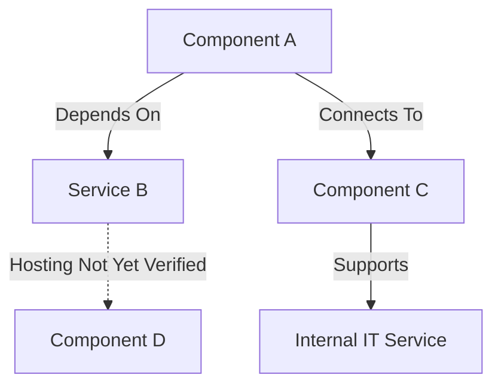

# DM-### — Dependency Map Title

**Organization:** Technical Techno Tech (TTT)  
**Practice:** Service Configuration Management  
**Document Type:** Dependency Map Record  
**Dependency Map ID:** DM-###  
**Version:** 1.0  
**Status:** Draft — Pending Verification  
**Map Owner:** To Be Assigned  
**Function:** Internal IT  
**Environment:** To Be Defined  
**Date Created:** YYYY-MM-DD  
**Last Reviewed:** Not Yet Reviewed  
**Next Review Date:** Not Yet Established  
**Classification:** Public Portfolio — Sanitized Lab Documentation

---

# 1. Dependency Map Overview

## 1.1 Purpose

[Describe why this dependency map is being created.]

This map documents the relationships between Configuration Items (CIs), infrastructure components, technical services, and internal IT services within the defined environment.

The objectives are to:

- Identify components supporting service delivery.
- Document technical and operational dependencies.
- Understand relationships between infrastructure components.
- Identify potential single points of failure.
- Evaluate redundancy and recovery considerations.
- Support incident investigation.
- Support problem investigation and root cause analysis.
- Support change impact assessment.
- Improve monitoring and event correlation.
- Support configuration verification.
- Maintain accurate service configuration information.

**Key Principle:** Dependency maps should distinguish confirmed technical relationships from proposed, assumed, or unverified relationships.

## 1.2 Map Summary

**Map Name:** [Enter descriptive name]

**Description:**

[Briefly describe the infrastructure or service represented by this map.]

**Primary Objective:** [Specify]

**Primary Service:** [IT-SVC-###]

**Primary Environment:** [Specify]

**Map Type:** [Select applicable type]

- [ ] Service Dependency Map
- [ ] Infrastructure Dependency Map
- [ ] Application Dependency Map
- [ ] Network Dependency Map
- [ ] Cloud Service Dependency Map
- [ ] Security Dependency Map
- [ ] Other: [Specify]

## 1.3 Mapping Status

**Current Status:** Draft — Pending Verification

**Documentation State:**

- [ ] Proposed Architecture
- [ ] Partially Documented
- [ ] Documented — Pending Verification
- [ ] Partially Verified
- [ ] Verified Within Defined Scope
- [ ] Under Review
- [ ] Retired

### Important

A verified map means that its defined relationships have been checked within the documented scope.

It does not necessarily establish that every service dependency, failure scenario, or security control has been tested.

---

# 2. ITIL 4 Alignment

This record supports the ITIL 4 Service Configuration Management practice.

The purpose of Service Configuration Management is to ensure that accurate and reliable information about the configuration of services, and the configuration items that support them, is available when and where needed.

Dependency maps complement individual CI records by documenting relationships between components.

### Related Activities

- Configuration identification
- Relationship documentation
- Configuration verification
- Service impact assessment
- Change impact assessment
- Incident investigation
- Problem investigation
- Security risk assessment
- Continual improvement

### Important

Dependency mapping is an activity supporting Service Configuration Management.

It is not a separate mandatory ITIL 4 practice.

---

# 3. Scope and Boundaries

## 3.1 In-Scope Components

Identify the infrastructure, applications, and services covered by this map.

- [Component or service]
- [Component or service]
- [Component or service]

## 3.2 Out-of-Scope Components

Identify systems or relationships intentionally excluded.

- [Excluded component]
- [Excluded relationship]

## 3.3 Environment Information

| Attribute | Value |
|---|---|
| Environment Name | [Name] |
| Environment Type | [Lab / Test / Production / Simulated] |
| Domain | [Domain or Not Applicable] |
| Cloud Tenant | [Tenant or Not Applicable] |
| Virtualization Platform | [Platform or Not Applicable] |
| Network Scope | [Network or Not Yet Verified] |
| Documentation Owner | [Role] |

## 3.4 Mapping Assumptions

| Assumption ID | Description | Verification Required |
|---|---|---|
| ASM-001 | [Assumption] | Yes |
| ASM-002 | [Assumption] | Yes |

### Important

Assumptions must not be represented as confirmed configuration information.

---

# 4. Related IT Services

Identify the internal IT services supported by the mapped components.

| Service ID | Service Name | Relationship to Map | Criticality |
|---|---|---|---|
| IT-SVC-### | [Service Name] | [Description] | Not Yet Assessed |

### Available Internal IT Services

| Service ID | Service |
|---|---|
| IT-SVC-001 | Identity & Access Management |
| IT-SVC-002 | Endpoint Management |
| IT-SVC-003 | Microsoft 365 & Collaboration |
| IT-SVC-004 | Network Connectivity |
| IT-SVC-005 | Server & Infrastructure Services |
| IT-SVC-006 | Information Security |
| IT-SVC-007 | Employee IT Lifecycle |

### Service Relationship Notes

[Explain how the mapped infrastructure contributes to service delivery.]

---

# 5. Configuration Item Inventory

List the CIs represented in the dependency map.

| CI ID | CI Name | CI Type | Operational Role | Lifecycle Status | Verification Status |
|---|---|---|---|---|---|
| CI-### | [Name] | [Type] | [Role] | [Status] | Pending |
| CI-### | [Name] | [Type] | [Role] | [Status] | Pending |

## 5.1 CI Documentation References

| CI ID | CI Record | Notes |
|---|---|---|
| CI-### | [Relative link to CI record, if available] | [Notes] |

### Configuration Item Categories

- Servers
- Workstations
- Network Devices
- Cloud Services

### Related Documentation

[Configuration Item Documentation Standards](../Service-Configuration-Management/Configuration-Items/README.md)

[Configuration Item Template](Configuration-Item-Template.md)

### Important

A component may appear on a conceptual dependency map before a corresponding CI record has been created.

When this occurs, identify the missing CI record rather than inventing a CI identifier.

---

# 6. Dependency Diagram

## 6.1 Diagram Purpose

[Describe what the diagram represents.]

## 6.2 Diagram Legend

| Diagram Element | Meaning |
|---|---|
| Solid Arrow | Documented dependency or relationship |
| Dashed Arrow | Proposed, conditional, or unverified relationship |
| Component Node | Infrastructure component or CI |
| Service Node | Logical or technical service |
| Relationship Label | Defines the interaction |
| Group or Boundary | Represents an environment, network, or logical grouping |

### Important

The legend defines the intended visual notation.

Verification status must also be documented in the relationship table.

A solid arrow alone is not evidence that a relationship has been verified.

## 6.3 Mermaid Dependency Diagram

Replace the example nodes with the actual components.



### Diagram Instructions

1. Replace placeholder component names.
2. Use actual CI identifiers where available.
3. Label relationship types.
4. Maintain consistent arrow direction.
5. Distinguish proposed relationships from verified relationships.
6. Include relevant service dependencies.
7. Avoid unnecessary diagram complexity.
8. Use multiple focused maps when one diagram becomes difficult to interpret.

## 6.4 Diagram Direction

For relationships labeled **Depends On**, the arrow should point from the dependent component to the component or service it requires.

Example:

```text
CLIENT01
   |
   | Depends On
   v
DNS Service
```

Other relationship types must have explicitly defined meanings.

## 6.5 Diagram Verification

**Diagram Reviewed:** No

**Diagram Accuracy:** Not Yet Verified

**Verification Date:** Pending

**Verified By:** Not Applicable

**Known Limitations:**

[Document limitations.]

---

# 7. Dependency Relationship Register

Document each relevant relationship separately.

| Relationship ID | Source CI or Service | Relationship Type | Target CI or Service | Criticality | Verification Status |
|---|---|---|---|---|---|
| REL-001 | [Source] | [Relationship] | [Target] | Pending | Pending |
| REL-002 | [Source] | [Relationship] | [Target] | Pending | Pending |
| REL-003 | [Source] | [Relationship] | [Target] | Pending | Pending |

## 7.1 Relationship Types

| Relationship | Description |
|---|---|
| Depends On | A component requires another component or service |
| Supports | A component contributes to service delivery |
| Hosts | A platform hosts another component |
| Hosted On | A component operates on another platform |
| Connects To | Components communicate through a connection |
| Authenticates Through | A component relies on an authentication service |
| Resolves Through | A component relies on DNS |
| Managed By | A component is administered through a management system |
| Monitored By | A component is observed by a monitoring system |
| Protected By | A component relies on a security control |
| Replicates With | Components exchange replicated information |
| Routes Through | Network traffic traverses a routing component |
| Stores Data On | A component uses another resource for storage |

## 7.2 Relationship Details

### REL-001 — [Relationship Description]

**Source:** [CI or service]

**Relationship:** [Type]

**Target:** [CI or service]

**Purpose:**

[Explain why the relationship exists.]

**Technical Function:**

[Describe the relevant technical behavior.]

**Required Protocols or Interfaces:** [Specify if applicable]

**Dependency Criticality:** Not Yet Assessed

**Verification Status:** Pending Verification

**Supporting Evidence:** Not Yet Available

**Failure Impact:**

[Describe potential consequences.]

**Notes:**

[Additional information.]

### Additional Relationships

Repeat this subsection for relationships requiring detailed documentation.

---

# 8. Dependency Classification

## 8.1 Dependency Importance

| Classification | Description |
|---|---|
| Critical | Failure may prevent delivery of an essential service |
| High | Failure may significantly degrade service functionality |
| Medium | Failure may affect some functions or users |
| Low | Failure has limited operational impact |
| Unknown | Impact has not been evaluated |

## 8.2 Dependency Requirements

For each important dependency, identify whether it is:

- [ ] Mandatory for the documented function
- [ ] Conditional
- [ ] Optional
- [ ] Redundant
- [ ] Shared
- [ ] Not Yet Determined

## 8.3 Dependency Assessment

| Relationship ID | Requirement Type | Criticality | Rationale |
|---|---|---|---|
| REL-001 | [Type] | [Criticality] | [Explanation] |

### Important

Dependency importance may vary according to the operation being performed.

For example, a domain-joined Windows workstation may use cached credentials when a domain controller is temporarily unavailable.

Therefore, authentication dependencies must be described in the context of the specific function being evaluated.

---

# 9. Upstream and Downstream Dependencies

## 9.1 Upstream Dependencies

Identify components or services required by the mapped system.

| Component | Required Dependency | Purpose | Verification |
|---|---|---|---|
| [Component] | [Dependency] | [Purpose] | Pending |

## 9.2 Downstream Dependents

Identify components or services that rely on the mapped system.

| Supporting Component | Dependent Component or Service | Potential Impact |
|---|---|---|
| [Component] | [Dependent] | [Impact] |

## 9.3 Shared Dependencies

Identify components used by multiple services.

| Shared Component | Dependent Services | Potential Shared Risk |
|---|---|---|
| [Component] | [Services] | [Risk] |

### Important

Shared dependencies may create correlated failures.

A single infrastructure failure can affect several otherwise separate services.

---

# 10. Redundancy and High Availability

## 10.1 Redundant Components

| Service or Function | Primary Component | Alternative Component | Verification Status |
|---|---|---|---|
| [Function] | [Component] | [Component] | Pending |

## 10.2 Redundancy Assessment

**Redundancy Present:** Not Yet Determined

**Redundancy Type:** [Specify]

**Failover Mechanism:** [Specify or Not Applicable]

**Failover Tested:** No

**Last Test Date:** Not Applicable

**Evidence:** Not Yet Available

## 10.3 Redundancy Verification Questions

- [ ] Alternative component exists
- [ ] Alternative component is operational
- [ ] Required configuration is present
- [ ] Clients can discover or access the alternative
- [ ] Shared dependencies have been evaluated
- [ ] Failover behavior has been tested where appropriate
- [ ] Recovery limitations documented

## 10.4 Redundancy Findings

[Document actual findings.]

### Important

Multiple servers or network devices do not automatically establish high availability.

Redundancy must be evaluated against the relevant failure scenario and actual configuration.

---

# 11. Single Points of Failure

Identify components whose failure may interrupt a required service because no effective alternative is available.

| SPOF ID | Component | Affected Service | Potential Impact | Mitigation Status |
|---|---|---|---|---|
| SPOF-001 | [Component] | [Service] | [Impact] | Pending Assessment |

## 11.1 Single Point of Failure Assessment

**Component:** [Name]

**Function:** [Describe]

**Alternative Available:** [Yes / No / Unknown]

**Shared Infrastructure:** [Specify]

**Potential Service Impact:**

[Describe.]

**Current Mitigation:**

[Describe or Not Yet Established.]

**Recommended Improvement:**

[Describe.]

**Related Improvement ID:** [IMP-### or Not Applicable]

### Important

A potential single point of failure should be identified as a risk until the failure condition and alternatives have been adequately assessed.

---

# 12. Service Impact Analysis

## 12.1 Impact Overview

**Affected Service:** [IT-SVC-###]

**Affected Component:** [CI-###]

**Failure Scenario:** [Describe]

**Potential Impact:**

[Describe the effect on service delivery.]

## 12.2 Impact Assessment

| Area | Potential Impact | Verification Required |
|---|---|---|
| Service Availability | [Impact] | Yes |
| User Access | [Impact] | Yes |
| Authentication | [Impact] | Yes |
| Network Connectivity | [Impact] | Yes |
| Security | [Impact] | Yes |
| Data Access | [Impact] | Yes |
| Administrative Operations | [Impact] | Yes |

Remove categories that do not apply.

## 12.3 Impact Scope

**Potentially Affected Users:** Not Yet Determined

**Potentially Affected Systems:** [List]

**Potentially Affected Services:** [List]

**Estimated Severity:** Not Yet Assessed

**Confirmed Impact:** Not Yet Verified

### Important

Potential impact must be distinguished from observed service disruption.

An unavailable component does not necessarily mean every dependent service is unavailable.

---

# 13. Failure Scenario Analysis

Document relevant hypothetical or tested failure conditions.

## 13.1 Scenario Identification

**Failure Scenario ID:** FAIL-001

**Scenario Name:** [Name]

**Affected Component:** [CI or service]

**Failure Type:** [Specify]

**Scenario Classification:**

- [ ] Hypothetical
- [ ] Simulated
- [ ] Observed in Lab
- [ ] Verified Through Controlled Testing

## 13.2 Expected Behavior

[Describe what is expected to happen.]

## 13.3 Actual Behavior

**Test Performed:** No

**Observed Result:** Not Available

**Evidence:** Not Available

## 13.4 Recovery Considerations

**Potential Recovery Method:**

[Describe.]

**Recovery Dependencies:**

[List.]

**Rollback Requirements:**

[Describe if applicable.]

## 13.5 Failure Scenario Findings

[Document findings.]

### Important

Do not intentionally disrupt shared, production, or unauthorized systems to test dependencies.

Controlled failure testing should be performed only within an appropriate, authorized lab environment.

---

# 14. Dependency Verification Plan

## 14.1 Verification Objective

Confirm that the documented relationships match the actual environment.

## 14.2 Verification Methods

Select applicable methods.

- [ ] PowerShell
- [ ] Windows administrative tools
- [ ] DNS queries
- [ ] Network connectivity testing
- [ ] Routing inspection
- [ ] Active Directory diagnostics
- [ ] Hyper-V configuration inspection
- [ ] Microsoft cloud administrative tools
- [ ] Network device CLI
- [ ] Configuration record comparison
- [ ] Controlled functional testing
- [ ] Other: [Specify]

## 14.3 Verification Test Cases

| Test ID | Relationship ID | Test Description | Expected Result | Status |
|---|---|---|---|---|
| TEST-001 | REL-001 | [Description] | [Expected] | Not Tested |
| TEST-002 | REL-002 | [Description] | [Expected] | Not Tested |
| TEST-003 | REL-003 | [Description] | [Expected] | Not Tested |

## 14.4 Verification Requirements

Each test should document:

1. Test identifier
2. Related relationship
3. Source system
4. Target system
5. Test method
6. Expected result
7. Actual result
8. Execution date
9. Verification outcome
10. Evidence reference

### Important

Tests must verify the specific relationship being claimed.

A successful ping does not establish that Active Directory authentication, DNS resolution, or application functionality is healthy.

---

# 15. Technical Verification Record

Complete this section when actual testing occurs.

## 15.1 Test Execution

**Test ID:** TEST-001

**Related Relationship:** REL-001

**Execution Date:** Pending

**Performed By:** Not Applicable

**Source System:** [Specify]

**Target System:** [Specify]

**Verification Method:** [Specify]

## 15.2 Expected Result

[Describe expected behavior.]

## 15.3 Commands or Actions

Record the actual commands or administrative actions performed.

```powershell
# Replace this placeholder with commands actually executed.
# Do not present example commands as execution evidence.
```

## 15.4 Actual Result

**Execution Status:** Not Executed

**Observed Result:** Not Available

**Error Messages:** Not Applicable

**Evidence Reference:** Not Available

## 15.5 Verification Outcome

Select one after evaluation.

- [ ] Verified
- [ ] Partially Verified
- [ ] Discrepancy Identified
- [ ] Unable to Verify
- [x] Not Yet Verified

## 15.6 Verification Notes

[Document limitations, unexpected results, or follow-up actions.]

---

# 16. Technical Verification Examples

The following examples illustrate possible verification methods.

They are not evidence that commands have been executed.

## 16.1 Active Directory Domain Controller Discovery

```powershell
nltest /dsgetdc:homelab.local
```

**Purpose:** Identify a domain controller discovered for the specified domain.

**Limitation:** Does not verify the health of every domain controller.

## 16.2 Domain Controller Inventory

```powershell
Get-ADDomainController -Filter * |
Select-Object HostName, Site, IPv4Address
```

**Purpose:** Retrieve domain controller information.

**Requirements:** Appropriate Active Directory PowerShell module and access.

## 16.3 DNS Server Configuration

```powershell
Get-DnsClientServerAddress -AddressFamily IPv4
```

**Purpose:** Inspect configured DNS server addresses.

## 16.4 Domain Controller Locator Records

```powershell
Resolve-DnsName -Type SRV "_ldap._tcp.dc._msdcs.homelab.local"
```

**Purpose:** Inspect DNS SRV records used for domain controller discovery.

## 16.5 Active Directory Replication

```powershell
repadmin /replsummary
```

**Purpose:** Review replication status.

## 16.6 Network Connectivity

```powershell
Test-NetConnection 10.20.10.10 -Port 389
```

**Purpose:** Test TCP connectivity to the specified port.

**Limitation:** TCP connectivity alone does not prove that directory operations succeed.

## 16.7 Network Routing

```powershell
route print
```

**Purpose:** Inspect the local routing table.

## 16.8 Hyper-V Dependencies

Review the relevant virtual machine configuration using the installed Hyper-V management interface.

Potential attributes include:

- Virtual network assignment
- Virtual disk location
- Host resource allocation
- Virtual hardware configuration
- VM power state

## 16.9 Microsoft Cloud Dependencies

Use appropriate administrative interfaces to inspect:

- Tenant configuration
- Identity relationships
- Device enrollment
- Administrative assignments
- Service configuration
- Relevant licensing

### Important

Cloud service relationships vary according to configuration, permissions, licensing, and available features.

---

# 17. Dependency Verification Summary

| Relationship ID | Verification Method | Actual Result | Status | Evidence |
|---|---|---|---|---|
| REL-001 | [Method] | Not Tested | Pending | None |
| REL-002 | [Method] | Not Tested | Pending | None |
| REL-003 | [Method] | Not Tested | Pending | None |

## 17.1 Overall Verification Status

**Total Relationships:** [Count]

**Verified Relationships:** [Count]

**Partially Verified Relationships:** [Count]

**Unverified Relationships:** [Count]

**Discrepancies:** [Count]

**Overall Map Status:** Pending Verification

## 17.2 Verified Relationship Rate

```text
Verified Relationship Rate (%) =

Verified Relationships
---------------------- x 100
Documented Relationships
```

**Actual Result:** Not Yet Calculated

**Measurement Date:** Pending

### Important

Do not report a verified relationship percentage until the relationship population and verification outcomes have been established.

---

# 18. Configuration Discrepancies

Document differences between expected and observed relationships.

| Discrepancy ID | Relationship | Expected State | Actual State | Impact | Status |
|---|---|---|---|---|---|
| DISC-001 | [Relationship] | [Expected] | [Observed] | [Impact] | Open |

## 18.1 Discrepancy Investigation

**Discrepancy ID:** DISC-001

**Description:**

[Describe.]

**Detection Method:** [Specify]

**Affected Components:** [List]

**Potential Service Impact:** [Describe]

**Related Incident ID:** [INC-### or Not Applicable]

**Related Problem ID:** [PRB-### or Not Applicable]

**Required Action:**

[Describe.]

## 18.2 Resolution

**Action Taken:** Not Yet Performed

**Result:** Pending

**Verification:** Pending

**Evidence:** Not Available

### Important

A documentation discrepancy does not always require a technical configuration change.

If the actual configuration is correct, the appropriate action may be to update the dependency map.

---

# 19. Security and Trust Dependencies

## 19.1 Security Considerations

Identify relevant security relationships.

- Authentication dependencies
- Authorization dependencies
- Administrative access paths
- Network segmentation
- Security monitoring
- Firewall controls
- Identity services
- Sensitive service dependencies

## 19.2 Security Relationship Register

| Source | Security Dependency | Target | Risk | Verification |
|---|---|---|---|---|
| [Source] | [Relationship] | [Target] | [Risk] | Pending |

## 19.3 Trust Boundaries

**Trust Boundaries Identified:** [Yes / No / Pending]

**Description:**

[Describe relevant logical or network boundaries.]

## 19.4 Security Review

**Security Review Required:** [Yes / No / To Be Determined]

**Review Status:** Pending

**Findings:**

[Document.]

### Important

Sanitize sensitive access paths and security architecture before publishing documentation.

---

# 20. Monitoring and Event Relationships

## 20.1 Monitoring Coverage

| Component or Service | Monitoring Method | Monitoring Status | Evidence |
|---|---|---|---|
| [Component] | [Method] | Not Yet Verified | Pending |

## 20.2 Relevant Events

| Event Type | Source Component | Potentially Affected Dependencies |
|---|---|---|
| [Event] | [Source] | [Dependencies] |

## 20.3 Alert Correlation

**Related Monitoring Events:** [EVT-### or None]

**Related Alerts:** [ALERT-### or None]

**Potential Correlations:**

[Describe.]

### Important

A monitoring event involving one component does not automatically prove that every downstream service has failed.

Service impact requires appropriate investigation.

---

# 21. Change Impact Assessment

Dependency maps should be reviewed when changes may affect mapped relationships.

## 21.1 Proposed Change

**Change ID:** [CHG-### or Not Applicable]

**Change Description:**

[Describe.]

**Affected CIs:**

- [CI]
- [CI]

## 21.2 Potentially Affected Dependencies

| Relationship ID | Potential Impact | Required Validation |
|---|---|---|
| REL-001 | [Impact] | [Validation] |

## 21.3 Change Considerations

- [ ] Affected CIs identified
- [ ] Downstream dependencies reviewed
- [ ] Shared infrastructure considered
- [ ] Redundancy evaluated
- [ ] Service impact assessed
- [ ] Security implications reviewed
- [ ] Verification requirements identified
- [ ] Recovery requirements considered
- [ ] Documentation update planned

## 21.4 Post-Change Update

**Change Implemented:** [Yes / No / Not Applicable]

**Dependencies Reverified:** [Yes / No / Pending]

**Map Updated:** [Yes / No / Pending]

**Evidence:** [Reference]

### Important

A dependency map supports change impact assessment but does not authorize technical changes.

---

# 22. Incident and Problem Management Relationships

## 22.1 Related Incidents

| Incident ID | Description | Affected Dependency | Status |
|---|---|---|---|
| INC-### | [Description] | [Relationship] | [Status] |

## 22.2 Related Problems

| Problem ID | Description | Relevant Dependency | Status |
|---|---|---|---|
| PRB-### | [Description] | [Relationship] | [Status] |

## 22.3 Known Errors

| Known Error ID | Description | Affected Dependency | Workaround |
|---|---|---|---|
| KE-### | [Description] | [Relationship] | [Reference] |

## 22.4 Investigation Notes

[Document how the dependency map contributed to an investigation.]

### Important

A dependency relationship can identify a possible failure path.

It does not independently establish the root cause of an incident or problem.

---

# 23. Recovery and Resilience Considerations

## 23.1 Recovery Dependencies

| Service or Component | Required Recovery Dependency | Alternative Available |
|---|---|---|
| [Service] | [Dependency] | Unknown |

## 23.2 Recovery Requirements

**Recovery Objective:** [Specify or Not Yet Established]

**Recovery Method:** [Specify]

**Required Systems:** [List]

**Required Access:** [Specify]

**Backup Dependencies:** [Specify]

**Network Dependencies:** [Specify]

## 23.3 Recovery Validation

- [ ] Recovery dependencies documented
- [ ] Required systems identified
- [ ] Required access reviewed
- [ ] Backup availability checked where applicable
- [ ] Alternative dependencies evaluated
- [ ] Recovery testing performed where appropriate
- [ ] Actual results documented

**Recovery Verification Status:** Not Yet Verified

### Important

Documenting a recovery path does not prove that the recovery procedure works.

Recovery capability requires appropriate validation.

---

# 24. Improvement Opportunities

Identify opportunities discovered through dependency mapping.

## 24.1 Potential Improvements

- [ ] Remove a single point of failure
- [ ] Improve redundancy
- [ ] Improve monitoring coverage
- [ ] Correct configuration documentation
- [ ] Improve network segmentation
- [ ] Reduce unnecessary dependencies
- [ ] Improve recovery capability
- [ ] Standardize configuration verification
- [ ] Improve service documentation
- [ ] Other: [Specify]

## 24.2 Improvement Register

| Improvement ID | Opportunity | Expected Benefit | Status |
|---|---|---|---|
| IMP-### | [Description] | [Benefit] | Proposed |

### Related Documentation

[Improvement Register](../Continual-Improvement/Improvement-Register.md)

### Important

A potential improvement should be assessed before implementation.

Identifying an improvement does not establish that it has been authorized or completed.

---

# 25. Dependency Map Maintenance

## 25.1 Review Triggers

Review this map when:

- A CI is created.
- A CI is retired.
- A server role changes.
- A network configuration changes.
- A DNS or DHCP configuration changes.
- A cloud integration changes.
- A virtual machine is migrated.
- A significant incident occurs.
- A problem investigation identifies new relationships.
- A change affects mapped infrastructure.
- A security assessment identifies relevant dependencies.
- A scheduled review becomes due.

## 25.2 Proposed Review Frequency

**Review Frequency:** [Quarterly / Semiannual / Annual / Event-Driven]

**Next Review Date:** Not Yet Established

**Review Owner:** To Be Assigned

## 25.3 Review Checklist

- [ ] Map scope remains accurate
- [ ] CI records are current
- [ ] CI identifiers are correct
- [ ] Relationships remain valid
- [ ] Arrow directions are clear
- [ ] Service mappings remain accurate
- [ ] Redundancy is represented correctly
- [ ] Single points of failure reviewed
- [ ] Verification status updated
- [ ] Evidence references valid
- [ ] Related changes documented
- [ ] Revision history updated

## 25.4 Review Outcome

**Review Date:** Pending

**Reviewed By:** Not Applicable

**Outcome:** Not Yet Reviewed

**Required Updates:**

[Document.]

---

# 26. Evidence Register

| Evidence ID | Related Relationship or Test | Evidence Type | Description | Date | Location |
|---|---|---|---|---|---|
| EVD-001 | REL-001 | [Type] | [Description] | [Date] | [Path] |

## 26.1 Acceptable Evidence

- PowerShell output
- DNS query results
- Network configuration
- Active Directory diagnostic output
- Replication information
- Hyper-V configuration screenshots
- Cloud administrative configuration
- Network device CLI output
- Configuration verification records
- Functional test results

## 26.2 Evidence Requirements

Each item should identify:

1. Source system
2. Target system or service
3. Relationship being verified
4. Test method
5. Collection date
6. Expected result
7. Actual result
8. Verification outcome

## 26.3 Evidence Integrity

Do not fabricate:

- Network connections
- Authentication results
- DNS resolution
- Replication health
- Service availability
- Cloud integrations
- Redundancy
- Recovery success
- Change implementation

## 26.4 Evidence Security

Before publishing:

- Remove passwords.
- Remove API keys.
- Remove private keys.
- Sanitize personal information.
- Exclude confidential tenant information.
- Review network diagrams for sensitive details.

---

# 27. Documentation Quality Checklist

## Identification

- [ ] Unique Dependency Map ID
- [ ] Descriptive map title
- [ ] Map owner identified
- [ ] Environment defined
- [ ] Map purpose documented
- [ ] Scope established

## Configuration Items

- [ ] Relevant CIs identified
- [ ] CI identifiers verified
- [ ] CI records linked where available
- [ ] Missing CI records identified
- [ ] Supported services documented

## Relationships

- [ ] Relationship types defined
- [ ] Relationship directions clear
- [ ] Upstream dependencies identified
- [ ] Downstream dependents identified
- [ ] Shared dependencies documented
- [ ] Critical dependencies evaluated

## Resilience

- [ ] Redundancy assessed
- [ ] Potential single points of failure identified
- [ ] Shared infrastructure risks reviewed
- [ ] Recovery considerations documented

## Verification

- [ ] Verification methods defined
- [ ] Test cases documented
- [ ] Actual results recorded where available
- [ ] Assumptions labeled
- [ ] Verification status accurate
- [ ] Discrepancies documented

## Operational Integration

- [ ] Service impact assessed
- [ ] Incident relationships documented where applicable
- [ ] Problem relationships documented where applicable
- [ ] Change impacts reviewed where applicable
- [ ] Monitoring relationships documented
- [ ] Security considerations evaluated
- [ ] Improvement opportunities identified

## Maintenance

- [ ] Last review date accurate
- [ ] Next review requirements defined
- [ ] Revision history maintained
- [ ] Related records updated
- [ ] Evidence references checked

## Portfolio Accuracy

- [ ] Fictional organization identified
- [ ] Proposed architecture distinguished from verified infrastructure
- [ ] No fabricated technical relationships
- [ ] No unsupported test results
- [ ] No unverified redundancy claims
- [ ] Sensitive information removed
- [ ] Relative links verified

---

# 28. Document Review and Revision History

## Review Triggers

Review this template when:

- Dependency documentation requirements change.
- CI identification standards change.
- New relationship types are introduced.
- Infrastructure platforms change.
- Verification methods change.
- Service impact assessment requirements evolve.
- Security documentation standards change.
- Dependency Mapping guidance is revised.

## Revision History

| Version | Description |
|---|---|
| 1.0 | Initial reusable Dependency Map Template aligned with ITIL 4 Service Configuration Management |

---

## Portfolio Disclaimer

Technical Techno Tech is a fictional organization developed for hands-on IT training and professional portfolio development.

This template provides a standardized method for documenting service dependencies, infrastructure relationships, and Configuration Item interactions within a simulated corporate IT environment.

Organizational roles, dependency diagrams, service relationships, and failure scenarios may be conceptual or simulated.

Actual technical relationships must be supported by appropriate lab observations and verification evidence before being represented as confirmed.

Example commands, diagrams, configuration information, and test procedures do not establish that systems have been deployed, integrated, tested, or validated.

Simulated organizational approvals do not constitute independent authorization or professional employment experience.

GitHub Markdown files are used as a lightweight documentation system and are not represented as an automatically synchronized enterprise Configuration Management Database.

The purpose of this template is to demonstrate dependency identification, relationship mapping, service impact assessment, technical verification, resilience evaluation, change impact analysis, security considerations, and configuration documentation maintenance.
